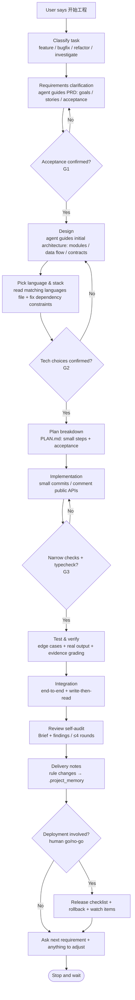

# engineering-craft · Layered Software Engineering Discipline

[](./LICENSE)
[](#installation)
[](#installation)
[](#how-to-trigger-it)

> Language: [中文](./README.md) · [English](./README.en.md)

A general-purpose agent skill that makes software engineering **disciplined, verifiable, and cumulative** — from requirements clarification to release and operations, every phase has entry conditions, structured handoffs, and exit criteria. Never carry unconfirmed upstream artifacts into the next phase.

**Not tied to any agent software.** It is a set of pure Markdown rules and calls no proprietary tools or private APIs — any agent that can load a skill / instruction directory can use it.

## What it solves

- Writing code before requirements are clear, then discovering halfway that the direction was wrong
- Saying "should be fine" after a change, with no real commands or output as evidence
- Not being able to tell whether a claim is measured, inferred, or guessed — and losing the trail when something breaks
- Project conventions scattered across chats, lost on the next session, leaving newcomers with nothing to start from
- Using one process for both small and large tasks — either too heavy or too sloppy

## How to trigger it

Say **"开始工程"** (the exact four Chinese characters) to enter the engineering-memory flow; day-to-day coding, bug fixing, debugging, refactoring, and code review also use this skill.

Once triggered: determine the task type → read the relevant rule layer → code by the flow → verify → deliver → (release/operate if deployment is involved) → ask for the next requirement.

## When to use it

**Good fits**:
- Code-engineering tasks with real scale or multi-person / multi-agent collaboration — new features, refactors, cross-module changes, long-lived projects.
- Cases that need an **auditable** process: handoffs on disk, gates with confirmation, claims backed by evidence, conventions that accumulate across sessions.
- Work where quality and process discipline matter more than "fastest possible output" (production code, open source, team projects).
- Agent environments with subagents, where you want Product / Architect / Developer / Tester / Reviewer / Ops to collaborate in artifact-dependency order.

**Poor fits / trim as needed**:
- One-shot tiny edits (typo, constant tweak): don't keep the full handoff set — trim to the minimum per ACDL; but if requirements aren't clear (G1 not passed), still don't write code.
- Pure chat, research, docs, or non-code tasks: this skill does not trigger.
- Strongly sequential tightly coupled work (e.g. TDD red→green→refactor): use a single agent, don't force parallelism.
- **Systems without hooks**: this skill is discipline and verifiability, not physical enforcement — it makes violations visible and checkable, but cannot stop an agent from breaking a gate. Don't treat it as a system-level guardrail.

## How to use it

1. **Install**: see "Installation" below — put the directory in your agent's skills location and reload.
2. **Trigger**: say "开始工程" (the exact four Chinese characters), or let the skill auto-load during day-to-day coding / bug fixing / refactoring / review per its description.
3. **Classify the task**: requirements clarification → new feature (`workflows/feature.md`) / bugfix (`bugfix.md`) / refactor (`refactor.md`) / investigate (`investigate.md`).
4. **Pass gates before coding**: confirm G1 (requirements / PRD with testable acceptance) and G2 (design / ADR + contract); if not passed, fill the upstream first — no implementation code.
5. **Read layers on demand**: read the matching `core/` file when entering a phase; **before writing code**, read the relevant `languages/` file for the detected main language; layer in `topics/` for security / performance / concurrency / API design. Don't read everything at once.
6. **Multi-agent collaboration** (optional): roles follow artifact-dependency order in form A (sequential role pipeline); enable form B parallelism only inside the developer role / test preparation when files don't overlap and all three gates pass. A defect in an upstream artifact freezes downstream and returns that artifact to its role. See `workflows/multi-agent-feature.md`.
7. **Code & verify**: small commits, comment public APIs; run real commands and paste real output; label claims measured / inferred / guessed; after two failures, attack the premises.
8. **Integrate & deliver**: for multi-module work run end-to-end checks — every state write must be verified as "write-then-read"; then review self-audit → delivery notes → (human go/no-go if deployment is involved); write rule changes back to `.project_memory/`.
9. **Wrap up**: ask for the next requirement and whether anything needs adjusting, then stop and wait.

> Remember: the entry `SKILL.md` is navigation — read the detailed rules on demand via its tables, never from memory.

### Usage flow

The full path from "开始工程" to delivery. **Humans make only three calls: confirm acceptance criteria (G1), confirm tech choices (G2), and go/no-go for release**; the agent drives everything else through the gates.



> Small tasks trim per ACDL: some handoffs may be skipped, but the G1 entry condition (no code before requirements are clear) is never trimmed.

## How it works

A four-layer architecture, **thin entry + read on demand** — `SKILL.md` keeps only navigation and red lines in context; the detailed rules live in the files reached through the navigation table, never from memory.

| Layer | Directory | When to read |
|---|---|---|
| L1 General rules | `core/` | On entering a project phase (requirements / design / coding / test / integration / acceptance / verification / review / delivery / release & operate / retrospective) |
| L2 Workflows | `workflows/` | When the task type is clear (bugfix / feature / refactor / investigate) |
| L3 Language rules | `languages/` | **After identifying the project's main language, before writing any code** — read that language's file |
| L4 Cross-cutting topics | `topics/` | Layer in when the task touches security / performance / concurrency / API design / refactoring |

### Six Phases (Role × Phase × Handoff)

Layered on top of the four directories is a **six-phase pipeline** — Product → Architect → Developer → Tester → Reviewer → Ops. Every phase has explicit **entry conditions**, **structured handoffs**, and **exit criteria**:

| Phase | Role | Entry condition (hard gate) | Handoff | Exit criteria |
|---|---|---|---|---|
| ① Requirements | Product | Requirement input in hand (testable-acceptance seed or raw material to clarify) | **PRD** (goals / user stories / priorities / open questions) | Human confirms acceptance criteria (G1) → design may start |
| ② Design | Architect | G1 passed: PRD exists, acceptance criteria confirmed and on disk | **ADR** (what/why/trade-offs) + interface contract + two sketches | Human confirms tech choices (G2) → coding may start |
| ③ Implementation | Developer | G2 passed: ADR + contract on disk, choices confirmed | Compilable small commits + **PLAN.md** | Narrow checks / typecheck pass (G3) → testing may start |
| ④ Test & Verify | Tester | G3 passed: code compiles, narrow checks pass, handoffs complete | Test code + coverage/edge-case report + real output | All green with complete evidence grading → review may start |
| ⑤ Review | Reviewer | Tests green, evidence complete; unchecked changes are not sent for review | **Brief** + **findings** (id/severity/file:line/issue/fix) | VERDICT: APPROVE, ≤4 rounds → delivery may start |
| ⑥ Delivery & Release | Ops | Review APPROVE, PR/merge notes ready | PR/merge notes → release checklist + rollback plan + watch items | Human makes go/no-go → may release |

**Bidirectional hard-gate discipline**: each phase gates both entry and exit — if entry conditions aren't met, stop at the current phase and say exactly "what's missing and from whom", never carry unconfirmed upstream artifacts forward; if exit criteria aren't met, don't release the downstream phase. Architecture choices, go/no-go, and incident command belong to humans; the agent only generates/analyzes/assists. Small tasks may trim "which phases leave handoffs" per ACDL, but **entry conditions are not what gets trimmed** — if requirements aren't clear (G1 not passed), implementation code must not be written.

### Three hard phase gates

- **G1**: Requirements (PRD) not confirmed to testable acceptance criteria → no implementation code
- **G2**: Design (ADR + interface contract) not confirmed → no coding
- **G3**: Checks not passed → no review submission

### Multi-agent collaboration

Multi-agent is an organizational approach, not merely acceleration. Two forms: a **sequential role pipeline** (roles follow strict artifact-dependency order) that can be used as the whole workflow, and **conditional parallelism** inside one role. **Roles follow that order strictly** (product→architecture is causal; review needs the final diff; release needs a human decision — none of these can parallelize). **Only the developer role and test preparation may parallelize conditionally**, and only when all three gates pass: ① capability gate (the environment has subagent tools and policy allows it); ② task-shape gate (≥2 units with no overlapping file ownership, each with testable acceptance); ③ payoff gate (the task is big enough to amortize coordination cost). A defect found in an upstream artifact freezes all downstream units and returns that artifact to its role for revision; an externally unverifiable contract converges to an already-verified mechanism with an ADR record instead of guessing APIs. See `workflows/multi-agent-feature.md` for details.

### Engineering memory

`开始工程` creates `.project_memory/` (a hidden directory) at the project root, accumulating that project's rules, conventions, and decisions — rules only, no session transcripts; recognized by the `.engineering-craft` marker, with a fallback directory on name collision, never writing into someone else's directory.

### Standing P0 rules

1. Read the relevant language rules before writing code.
2. Verify every change: run real commands, paste real output; never claim completion without verification.
3. Every public API must be commented.
4. Evidence levels: measured / inferred / guessed; never fabricate APIs, libraries, docs, or test results.
5. One thing at a time; after two failures, attack the premises.
6. Security by default: untrusted input, least privilege, no hardcoded secrets.
7. Confirm target paths before destructive operations.
8. Be capability-honest: rules that only a hook can enforce are written here as discipline; degrade explicitly when tools are absent.
9. Hard phase gates: never enter a downstream phase while upstream entry conditions are unmet.

## Installation

This skill is just a directory with no runtime dependencies: **pure Markdown — no code, no build, no platform-specific API**; engineering memory is ordinary files in the project (`.project_memory/`), and the entry is `SKILL.md` with YAML frontmatter — usable by any agent that can load a skill directory. Put it wherever your agent software loads skills from, restart the session (or reload skills), then say "开始工程".

Common skills directories (check your software's actual version):

| Agent | Common location |
|---|---|
| Claude Code | `~/.claude/skills/` or the project's `.claude/skills/` |
| Cline / Roo Code | the project's custom instruction directory (e.g. `.clinerules/`) |
| Other skill-capable agents | that software's skills / instructions directory |

> Different agents have different entry-point conventions: some read `SKILL.md` + frontmatter, others use a different filename or format. This skill's entry point is `SKILL.md`; if your agent uses another convention, just point it at the entry file — the four-layer content needs no changes.

Install from the repository:

```bash
git clone https://github.com/zycskylove520/engineering-craft.git
# then copy the whole engineering-craft/ directory into your agent's skills directory
```

## Directory structure

```
engineering-craft/
├── SKILL.md              # thin entry: navigation, red lines, phase gates, engineering memory
├── CHANGELOG.md          # evolution log
├── README.md             # Chinese documentation (default)
├── README.en.md          # English documentation
├── core/                 # L1 general rules (read by phase)
│   ├── INDEX.md
│   ├── requirements.md / design-principles.md / coding-standards.md
│   ├── testing-strategy.md / verification.md / review.md
│   ├── integration.md / acceptance.md / delivery.md
│   ├── release-and-operate.md / retrospective.md
│   ├── operations.md / project-memory.md / gate-metrics.md
├── workflows/            # L2 workflows (read by task type)
│   ├── INDEX.md
│   ├── feature.md / bugfix.md / refactor.md / investigate.md
│   └── multi-agent-feature.md
├── languages/            # L3 language rules (read the relevant one before coding)
│   ├── INDEX.md / _TEMPLATE.md
│   ├── typescript.md / python.md / go.md / java.md / rust.md
│   └── cpp.md / cuda.md / bash.md / powershell.md
└── topics/               # L4 cross-cutting topics (layer in when relevant)
    ├── INDEX.md
    ├── security.md / performance.md / concurrency.md
    ├── api-design.md / refactoring.md
```

## License

[MIT](./LICENSE)
